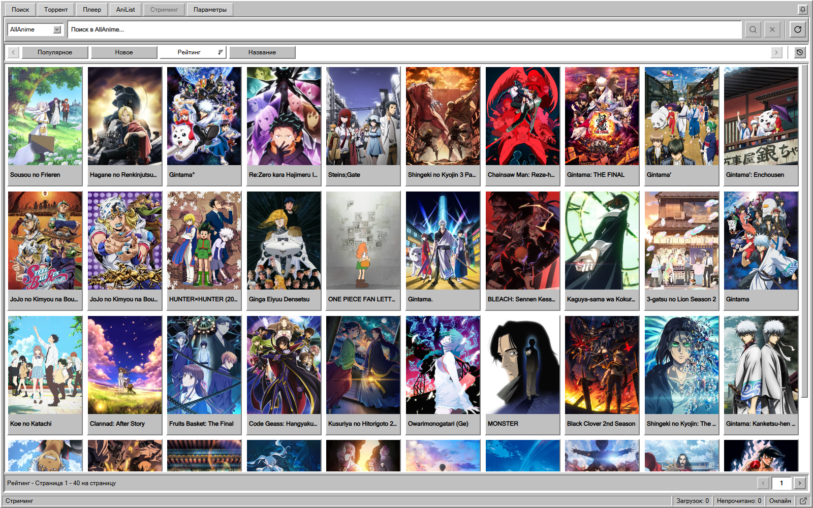
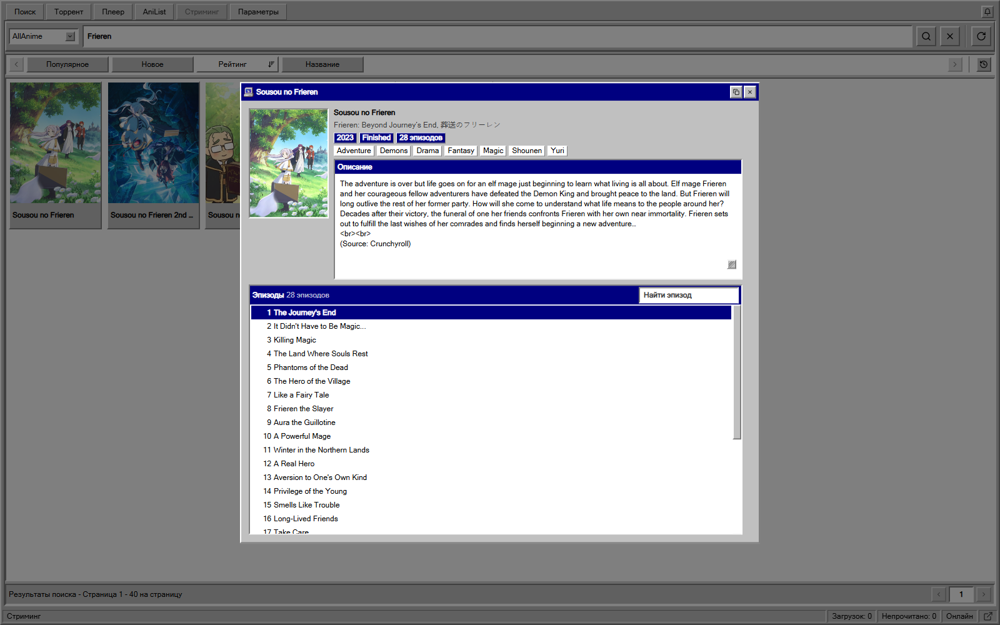
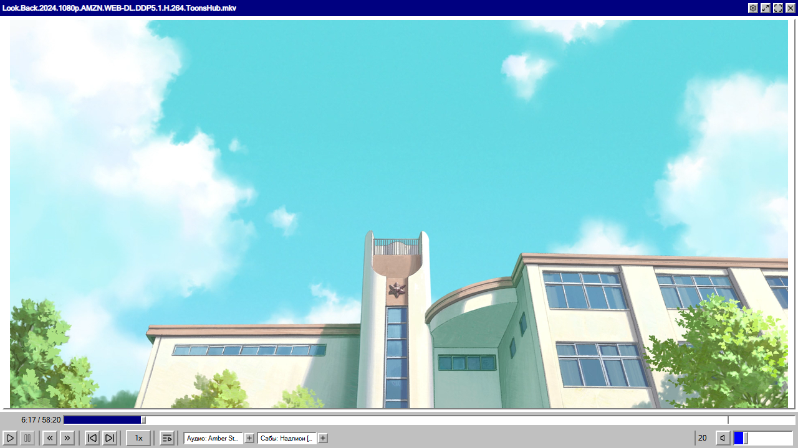
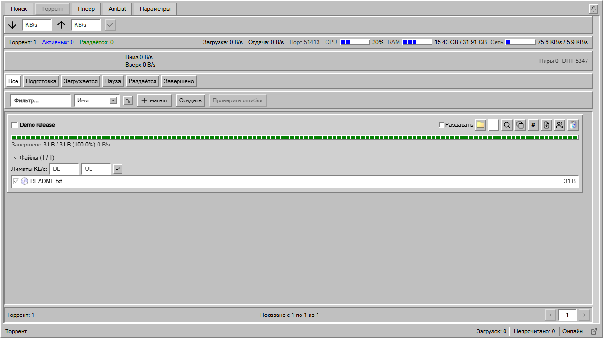
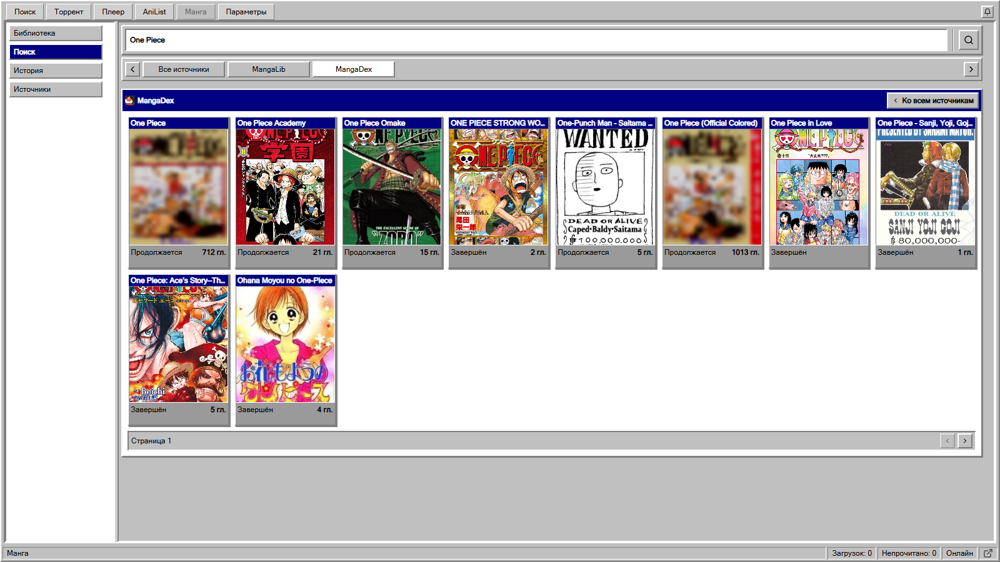

<h1 align="center">iluhaAnime</h1>

Anime tracker, torrent client, and mpv player for Windows.

  
  

Track your watchlist with AniList, search and download torrents, and play local files or streams. The interface is in Russian.

Peer country data by <a href="https://db-ip.com">DB-IP Lite</a> (<a href="https://creativecommons.org/licenses/by/4.0/">CC BY 4.0</a>). Country flags by <a href="https://github.com/lipis/flag-icons">flag-icons</a> (MIT), via <a href="https://flagcdn.com">FlagCDN</a>.
